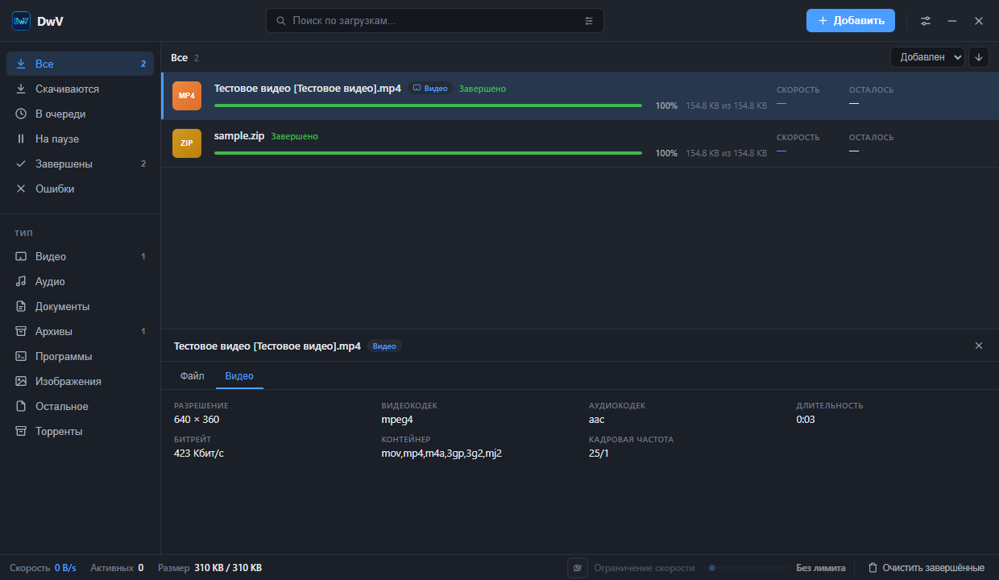
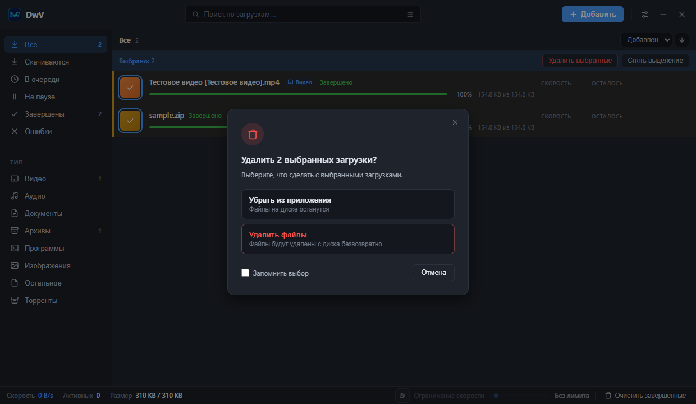
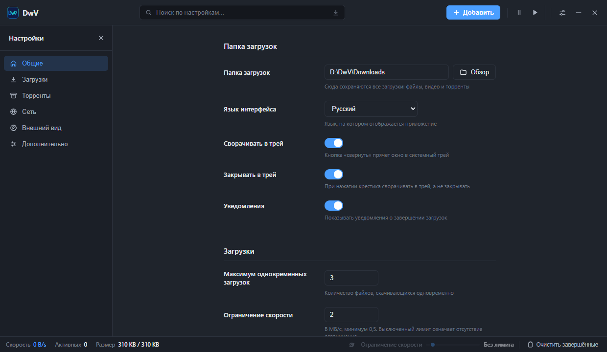
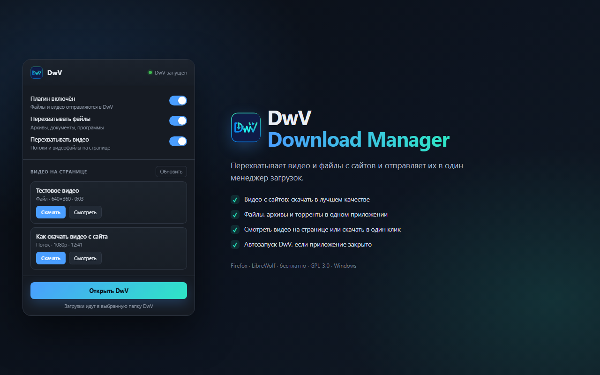
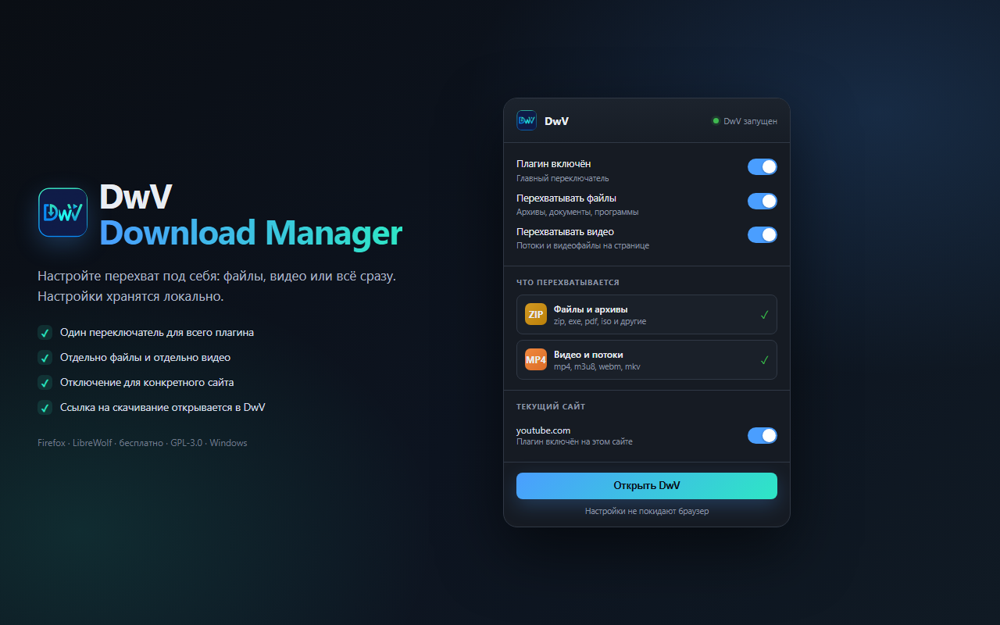

<p align="center">
  
</p>

<h1 align="center">DwV — Download Manager</h1>

<p align="center">Менеджер загрузок для Windows: файлы, видео и торренты в одном приложении.</p>

<p align="center">
  <a href="https://github.com/DezFix/DwV/releases/latest">Скачать</a> ·
  <a href="extension/INSTALL.md">Установить расширение</a> ·
  <a href="https://ko-fi.com/dezfix">Поддержать на Ko-fi</a>
</p>



## Возможности

- HTTP/HTTPS-загрузки с докачкой, очередью и ограничением скорости. Упавшую загрузку можно повторить с того же места.
- Пауза и продолжение для всех типов загрузок, включая видео.
- После перезапуска незавершённые файлы, торренты и видео продолжаются сами; приостановленные продолжаются кнопкой из истории.
- Видео с сайтов через yt-dlp: YouTube и другие площадки, лучшее качество или 1080p/720p/480p.
- Торренты через librqbit: magnet-ссылки, `.torrent`-файлы и URL, пиры, ограничение отдачи, DHT.
- Все загрузки сохраняются в одну папку, которую вы выбираете в настройках.
- Прокси (HTTP или SOCKS5) для файлов, видео и торрентов, свой User-Agent, уведомления о завершении и ошибках.
- Качество видео по умолчанию для ссылок из расширения.
- В сайдбаре типы: видео, аудио, документы (PDF), архивы, программы, изображения/GIF и торренты. Раздел «Источники» убран.
- Окно запоминает последний размер и позицию.
- Автозапуск вместе с Windows: включается в настройках, по умолчанию включён.
- yt-dlp проверяется раз в сутки и обновляется сам; ffmpeg и deno фиксированные.
- Установщик регистрирует `dwv://` и `magnet:`, поэтому расширение может запустить закрытое приложение. Если magnet-ссылки уже открывает другой клиент, DwV не отбирает их, а появляется в списке «Открыть с помощью».
- При запуске проверяются обновления на GitHub. Окно «Обновить / Пропустить»: кнопка открывает страницу релиза, установка вручную.
- Расширение для Firefox и LibreWolf: перехват файлов и видео, список видео на странице, просмотр и скачивание, автозапуск приложения.
- Расширение передаёт cookies, Referer и `final_url`, поэтому работают загрузки с авторизованных файлообменников.
- Попап показывает превью по ссылке страницы: обложку, название и кнопку «Скачать». Для YouTube/Vimeo данные берутся из oEmbed, для остальных сайтов из og:image.
- Скачать видео со страницы можно через контекстное меню браузера или кнопку в попапе, даже если автоматический список пуст.
- Если сайт требует капчу или вход, в деталях ошибочной загрузки есть кнопка «Открыть страницу»: пройдите проверку в браузере и повторите загрузку из расширения.
- Если файл уже существует, при ручном добавлении приложение спросит новое имя или отменит загрузку. Загрузки из расширения получают имя `файл (1).расширение` и не перезаписывают старое.
- Если сервер вернул HTML-заглушку вместо файла, загрузка завершится ошибкой, а не сохранится как битый архив.
- Клик по загрузке открывает нижнюю панель: путь, размер, статус, ссылка, метаданные видео, пиры торрента.
- Мультивыбор строк для массового удаления. Диалог удаления позволяет оставить файлы или удалить их с диска и запомнить выбор.
- Улитка в статус-баре включает общий лимит скорости (по умолчанию 2 МБ/с).
- Тёмная, светлая и системная тема, русский и английский язык, простые анимации.
- Сворачивание и закрытие в трей, восстановление окна из расширения.
- Ссылка Ko-fi в «О программе» и редкий баннер поддержки.

## Скриншоты

<p>
  
  
</p>

<p>
  
  
</p>

## Установка

1. Скачайте `DwV_<версия>_x64-setup.exe` из [последнего релиза](https://github.com/DezFix/DwV/releases/latest) или запустите portable exe.
2. Запустите DwV один раз. Приложение зарегистрирует протокол `dwv://` для автозапуска из расширения.
3. Установите расширение `dwv-firefox-<версия>.xpi` из релиза. Инструкция: [extension/INSTALL.md](extension/INSTALL.md).
4. Откройте настройки и выберите папку загрузок.

Windows 10/11. Для видео при первом запуске скачиваются yt-dlp и ffmpeg в `%APPDATA%\DwV\bin`.

## Как пользоваться

- Кнопка «Добавить» принимает ссылку на файл, ссылку на видео, magnet-ссылку или `.torrent`-файл. Ссылку можно вставить кнопкой «Вставить» при любой раскладке.
- Перетащите `.torrent` или ссылку в окно приложения.
- Клик по строке открывает детали. Вкладки зависят от типа: «Файл», «Видео» или «Пиры».
- Квадратная плитка с типом файла (MP4, ZIP, PDF) работает как чекбокс для массового удаления.
- Улитка рядом с ограничением скорости в статус-баре включает и выключает лимит.
- В настройках → «Дополнительно» можно выбрать, что делать при удалении: спрашивать, убирать из приложения или удалять файлы.

## Расширение

Расширение работает с запущенным DwV через локальный адрес `127.0.0.1:41763`. Если приложение закрыто, расширение откроет его через `dwv://` и повторит отправку. Cookies сайта, с которого идёт загрузка, передаются только в DwV на этом компьютере и в историю не записываются. Настройки хранятся локально в браузере.

- Панель: включение плагина, перехват файлов и видео, список видео на странице, «Смотреть», «Скачать», «Открыть DwV».
- Firefox/LibreWolf: установка из XPI. Обычный Firefox Release требует подписанное расширение; используйте LibreWolf, Developer/ESR или временную установку через `about:debugging`.
- Chrome: `extension/chrome` можно загрузить распакованным.
- В настройках расширения: минимальный размер файла для перехвата, сайты-исключения, качество видео.
- Исходник один — `extension/firefox`. Папка `extension/chrome` собирается из него командой `node extension/sync.mjs`; правится вручную только её `manifest.json`.

## Сборка

```powershell
cd ui
npm install
npm run tauri build
```

Артефакты: `ui/src-tauri/target/release/dwv.exe` и установщики в `ui/src-tauri/target/release/bundle/`.

Обновления проверяются через GitHub API. Кнопка «Обновить» открывает страницу релиза в браузере; приложение не скачивает и не устанавливает обновления само.

Расширение:

```powershell
node extension/build-xpi.mjs
```

Тесты:

```powershell
cargo test --workspace
cargo test --manifest-path ui/src-tauri/Cargo.toml
cd ui; npm run check; npm run build
node extension/sync.mjs --check
deno run --allow-read extension/test/background.test.mjs
```

## Структура

```
crates/
  dwv-core/     HTTP-движок, очередь, докачка, повтор, SQLite-история
  dwv-media/    yt-dlp, ffmpeg, ffprobe
  dwv-torrent/  librqbit, одна торрент-сессия
  dwv-ipc/      локальный HTTP/WebSocket IPC для расширения
  dwv-cli/      консольная версия
ui/             Tauri 2 + Svelte 5 интерфейс
  src-tauri/src/
    commands.rs   команды и общее состояние, маршрутизация по id
    video.rs      yt-dlp: пауза, продолжение, восстановление
    torrent.rs    торренты: добавление, восстановление, события
    ipc.rs        запросы от расширения
    names.rs      имена файлов, Content-Disposition, dwv://
    platform.rs   реестр Windows, автозапуск, «показать в папке»
    notify.rs     системные уведомления
extension/      Firefox/LibreWolf и Chrome расширение
docs/           контракт, скриншоты
store/          материалы для магазина Firefox
```

## Ограничения

- Прокси для торрентов работает только в режиме SOCKS5 и применяется после перезапуска приложения. Так же после перезапуска применяются DHT и максимальное число пиров. Лимиты скорости работают сразу.
- Cookies в историю не сохраняются. Поэтому загрузку с сайта, который требует входа, после перезапуска может понадобиться отправить из браузера заново.
- Торренты, добавленные в версии 0.2.x по magnet-ссылке, восстановить из истории нельзя: ссылка тогда сохранялась без параметров. Их нужно добавить заново.
- Обновление ставится вручную со страницы релизов GitHub; автоустановки нет.
- Расширение подписано в AMO и ставится как обычное дополнение.
- Настройки обрезки имён и авто-распаковки пока не влияют на загрузки и в интерфейсе не показаны.

## Лицензия

GPL-3.0-or-later. См. [LICENSE](LICENSE).

## Поддержка

- Ko-fi: https://ko-fi.com/dezfix
- Ошибки и идеи: https://github.com/DezFix/DwV/issues
